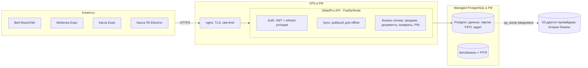

# Архитектура бэкенда SkladPro (self-hosted, v2)

Полностью автономный бэкенд для экосистемы SkladPro (веб + мобилка + касса + десктоп-касса): собственная аутентификация, собственный PostgreSQL на российском хостинге, синхронизация offline-first клиентов. **Supabase больше не используется.**

## 1. Общая схема

Ключевые решения:

| Область | Решение |
|---|---|
| Аутентификация | Своя: bcrypt-пароли, access-JWT (HS256, 15 мин) + refresh-токены (256 бит, в БД только sha256-хэш) с ротацией. Детекция кражи: reuse ротированного токена гасит всю семью сессий; **grace-окно 15 секунд** — ретраи после потерянного ответа на плохом LTE не карают. Регистрация НЕ авто-присоединяет к компаниям по приглашению (защита от захвата email); membership — только явным accept-эндпоинтом залогиненного пользователя |
| Мультитенантность | `companies` + `memberships` (роли admin/manager/stock/courier); каждая таблица данных имеет составной PK `(company_id, id)` — данные компаний физически не пересекаются, id клиентов не конфликтуют |
| Offline-синк | `GET /v1/sync/pull` — по **монотонному `row_version`** (bigserial, ставит триггер) вместо `updated_at`, чтобы не терять строки долгих транзакций и не резать курсор до миллисекунд. Ролевая фильтрация: курьер получает только orders/customers/warehouses/cells/employees без cost/PII. `POST /v1/sync/push` — батчи из клиентского outbox с `clientUpdatedAt` для LWW-защиты |
| Целостность | Критичные операции — только транзакционные эндпоинты с `SELECT … FOR UPDATE`; push-синку **запрещено** менять `stock`, `batches`, `movements`, `audit`, `pin_hash`, `role` сотрудника, `status`/`items` заказа. Заказ с `stock_consumed=true` нельзя удалить (HAS_STOCK_MOVEMENT) и воскресить upsert'ом (TOMBSTONE_LOCKED). Отмена заказа после частичного возврата вычитает уже возвращённое из items |
| Идемпотентность | Обязательный `Idempotency-Key` на всех денежных операциях. PK **`(company_id, key)`** — ключи разных компаний не пересекаются (нет cross-tenant DoS). Replay сверяет **endpoint**: тот же ключ на `/v1/returns` после `/v1/sales` → 409 `IDEMPOTENCY_MISMATCH`, не молчаливый возврат чужого ответа |
| Себестоимость | FIFO-партии (`products.batches`) ведёт сервер: приход создаёт партию, продажа ест по FIFO с записью COGS в movement. **Возврат / отмена восстанавливают партию** по цене из `order.items` (сохраняется при продаже), поэтому `sum(batches.qty) == stock` не разъезжается |
| Время | `updated_at` и `row_version` ставит только сервер (триггер `set_row_version`) — часы клиентов не ломают разрешение конфликтов. numeric из pg парсится в JS `number` глобально (`pg.types.setTypeParser`), bigint (курсоры) — как строка |

## 2. Поверхность API

| Группа | Эндпоинты |
|---|---|
| Auth | `POST /v1/auth/register` (+ optional `inviteToken` → auto-accept membership), `/login`, `/refresh`, `/logout`, `/password/change`, `/password/reset`, `/password/reset/confirm` (rate limit 10/мин/IP) |
| Компании | `POST /v1/companies`, `GET /v1/memberships`, `POST /v1/invitations` (возвращает `token`), `POST /v1/invitations/accept`, admin: `GET/DELETE /v1/invitations`, `PATCH/DELETE /v1/memberships/:userId`, `GET /v1/companies/members` |
| Синк | `GET /v1/sync/pull`, `POST /v1/sync/push` (enforcement лимитов плана: `SUBSCRIPTION_LIMIT_EXCEEDED`), `GET/PUT /v1/settings` |
| Бизнес | `POST /v1/sales`, `POST /v1/documents/post` (receive/writeoff/adjust), `POST /v1/orders/:id/status`, `POST /v1/returns`, `POST /v1/customers/:id/payments`, `POST /v1/products/:id/mark-codes` |
| Сотрудники | `POST /v1/employees/pin/set`, `/pin/verify` (bcrypt, 10/мин/IP) |
| Realtime | `GET /v1/events` (SSE через LISTEN/NOTIFY, auth через `?access_token=`) |
| Push | `POST /v1/push/tokens` (FCM токены устройств) |
| Support | `POST /v1/support/tickets` (n8n webhook + HMAC), `PATCH` callback от n8n |
| Подписка | `GET /v1/subscription`, `POST /v1/subscription/checkout` (ЮKassa), `POST /v1/subscription/webhook/yookassa`, super-admin: `POST /v1/admin/subscriptions/:companyId` |
| Fiscal 54-ФЗ | `GET/PUT /v1/fiscal/config` (АТОЛ, пароль AES-GCM), `POST /v1/fiscal/receipts` (Idempotency-Key), `GET /v1/fiscal/receipts/:id` |
| API-ключи | `GET /v1/api-keys`, `POST /v1/api-keys` (plain-секрет отдаётся 1 раз), `DELETE /v1/api-keys/:id` |
| Webhooks | `GET/POST/PUT/DELETE /v1/webhooks/endpoints` |
| Публичный API | `X-API-Key`: `GET /v1/public/products{,/:id}`, `GET /v1/public/customers`, `POST /v1/public/orders`, `GET /v1/public/orders/:id/status` (scope-based доступ) |
| GDPR / 152-ФЗ | `POST /v1/account/export`, `GET /v1/account/export/:jobId`, `GET /v1/account/export/download/:token`, `POST /v1/account/delete` (30-дневный grace), `POST /v1/account/delete/cancel` |
| Super-admin | `GET /v1/admin/stats`, `/companies`, `/users` |
| Служебные | `GET /health`, `GET /health/db`, `GET /v1/me`, `GET /metrics` (Prometheus, basic-auth) |

Мультикомпанийность: заголовок `X-Company-Id` (без него — первая компания пользователя). Ошибки везде: `{ "error": { "code", "message", "details?" } }`.

Realtime: SSE через PostgreSQL `LISTEN/NOTIFY` — сервер держит одно соединение с PG, каждый клиент получает нотификации без Redis (`skladpro_events` канал). Плюс исходящие webhook'и подписанным endpoint'ам с exp-backoff.

## 3. Защита от атак — слои

1. **Сеть**: nginx TLS 1.2/1.3, `limit_req` (2 r/s на auth, 20 r/s на API), Cloudflare (бесплатный) перед VPS против DDoS. БД не торчит в интернет — доступ только с IP VPS (private network хостера).
2. **Аутентификация**: bcrypt(11) ≈ 120 мс/попытку + 10 попыток/мин/IP → перебор бессмыслен; одинаковый ответ на «нет email» и «не тот пароль»; refresh-ротация с гашением семьи при краже. Публичный API — X-API-Key (sha256(secret) в БД), scope-based ACL.
3. **Авторизация**: каждая операция — проверка роли из БД (не из токена!) и company_id во всех WHERE; составной PK делает межтенантную утечку структурно невозможной.
4. **Целостность данных**: клиент не может подделать остатки/движения/аудит/суммы — эти поля пишет только сервер в транзакциях; `CHECK (stock >= 0)` — последний рубеж.
5. **Инъекции**: только параметризованные запросы; имена колонок в sync — по жёсткому whitelist; id — по регулярке.
6. **Утечки**: 5xx без SQL/стека; `pin_hash` исключён из pull; секреты редактируются из логов; body limit 512 КБ. Секреты уровня «пароль АТОЛ» — AES-GCM с ключом из `FISCAL_KMS_KEY`.
7. **БД**: TLS с проверкой CA (`DATABASE_SSL=verify`), пароль только в `.env` (600).
8. **Rate-limit per-tenant**: `keyGenerator` = `companyId → userId → ip`. Один шумный тенант не отберёт лимит у остальных.
9. **Audit-log**: `security_events` таблица — login_ok/fail, refresh_reuse_detected, password_change/reset, pin_verify_fail, api_key_created/used/revoked, webhook_delivery_fail, subscription_activated, super_admin_action. TTL 90 дней через `prune_security_events()`.

## 4. Надёжность и бэкапы

- **Managed PostgreSQL** с автобэкапами и PITR — основной контур (см. HOSTING.md).
- `deploy/backup.sh` — ежедневный `pg_dump` на **Яндекс.Диск** через WebDAV (правило 3-2-1: авария/блокировка одного провайдера не уносит и базу, и копии).
- Раз в квартал — тестовое восстановление дампа (бэкап без проверенного restore — не бэкап).
- systemd `Restart=always`, `/health` под UptimeRobot, Sentry на 5xx.
- API stateless → второй инстанс за nginx добавляется без изменений кода (кэш membership — 60 с TTL, при нескольких инстансах это просто минутная задержка смены роли).
- **Фоновые воркеры** (внутри того же `node dist/index.js`, отдельные systemd-юниты не нужны):
  - **push-worker** — FCM на события sale/order/return/payment (Notifee подавляет самоуведомления через `senderUserId` в data).
  - **fiscal-worker** — polling 30с: processing → getReport, pending → retry sell; при готовности `publishEvent(sale)` → SSE.
  - **webhook-dispatcher** — enqueue на publishEvent + polling 5с, exp-backoff 1мин/5мин/30мин/2ч/12ч/24ч × 7 попыток, HMAC-подпись `sha256(timestamp + '.' + body)`.
  - **export-worker** — GDPR-дамп раз в минуту, JSON в `payload jsonb`, TTL 48ч.
- **Cron** (отдельно, вне API): `select prune_security_events()`, `select prune_webhook_deliveries()`, `select prune_deleted_companies()`, `select prune_export_jobs()`.
- **Метрики**: `/metrics` (Prometheus) с basic-auth. Ключевые: `http_requests_total{route,status}`, `security_events_total{event}`, `webhook_deliveries_total{status}`, `subscription_limit_exceeded_total{feature}`, `fiscal_receipts_total{result}`, дефолтные Node.js метрики.

## 5. Масштаб «сотни компаний»

- Один VPS 2 vCPU / 4 ГБ + managed PG 2 vCPU / 4 ГБ держит сотни компаний уровня малого бизнеса (Fastify ~10к простых RPS; узкое место — БД).
- Рост: реплика чтения для `pull` → партиционирование `movements`/`audit` по месяцам → несколько API-инстансов.
- Фоновые задачи (push-уведомления, экспорт, «Честный знак») — `pg-boss` в том же Postgres; Redis не нужен до реального упора.
- 152-ФЗ закрыт по построению: и API, и данные — в ЦОД РФ.

## 6. Миграция с Supabase (порядок)

1. Развернуть Postgres + API (локально или сразу на VPS), `npm run migrate`.
2. `npm run migrate:from-supabase` — переносит всё, включая bcrypt-хэши паролей GoTrue → **пользователи входят старыми паролями**. PIN-хэши не переносятся — задать заново через `/v1/employees/pin/set`.
3. Переключить клиентов: слой `lib/cloud.js`/`outbox.js` в трёх приложениях меняет транспорт с supabase-js на `fetch` к API (pull/push — прямая замена `cloudLoadMerged`/`attachSync`; продажи/проводки — на бизнес-эндпоинты). Модель outbox/merge остаётся той же.
4. Неделя двойной работы (Supabase read-only) → отключить Supabase-проект.

## 7. SaaS-надстройки (2026-07)

- **Подписки/билинг** (`subscriptions` + `subscription_payments`): 14-дневный trial при создании компании (триггер), эффективный план вычисляется on-read (`effectivePlan`). ЮKassa checkout (`POST /v1/subscription/checkout`), webhook `payment.succeeded` продлевает `paid_until` (unique `external_id` защита от дубль-обработки). Enforcement в sync push при upsert `products/warehouses/employees` — 402 `SUBSCRIPTION_LIMIT_EXCEEDED`. Super-admin ручное выставление плана для оплат по счёту.
- **Fiscal 54-ФЗ через АТОЛ Онлайн** (`fiscal_configs` + `fiscal_receipts`): пароль ККТ AES-GCM в БД (`FISCAL_KMS_KEY` env). `POST /v1/fiscal/receipts` с Idempotency-Key `fiscal-<saleId>` + unique(sale_id). Sync вызов АТОЛ вне транзакции; worker получает `report` → FN/FD/FP → `publishEvent(sale)` → SSE.
- **Публичный REST API + webhooks**: `sk_live_<prefix>_<secret>` → sha256(secret) в БД. Scope-based access (`products:read`, `orders:write` и др.). Webhook-dispatcher enqueue на publishEvent → доставки по подписанным endpoint'ам с HMAC-подписью и exp-backoff.
- **GDPR / 152-ФЗ**: `POST /v1/account/export` → async job → JSON-дамп с одноразовым `download_token` (TTL 48ч). `POST /v1/account/delete` требует `passwordConfirm`, ставит `companies.deleted_at`, ревокает refresh + api-keys + деактивирует webhooks. Grace 30 дней, `POST /v1/account/delete/cancel`.

Чего в v2 пока нет (осознанно): эндпоинта перемещения между складами (transfer), ЕГАИС/«Честный знак» server-side, S3/SFTP-загрузка GDPR-экспорта (пока JSON в БД), email при готовности экспорта (SMTP уже есть, надо один вызов), SupportWidget в мобилке/POS (backend-endpoint готов).
